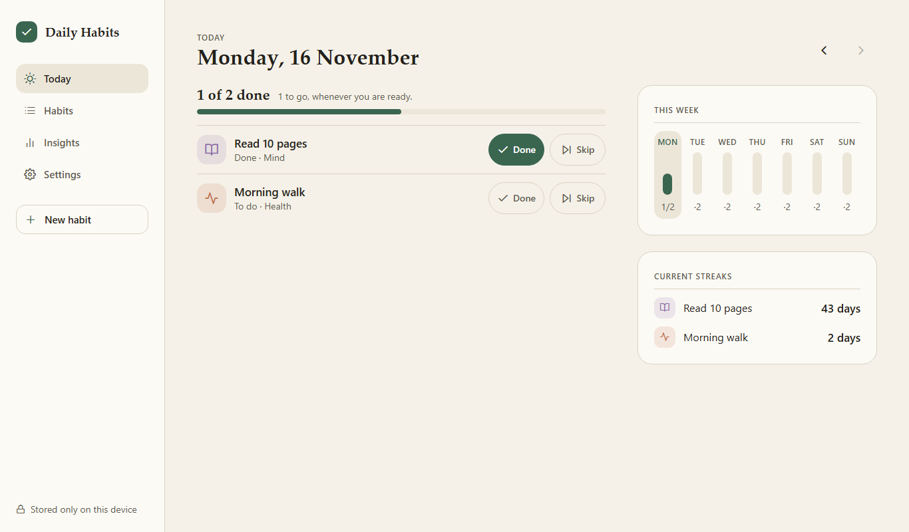
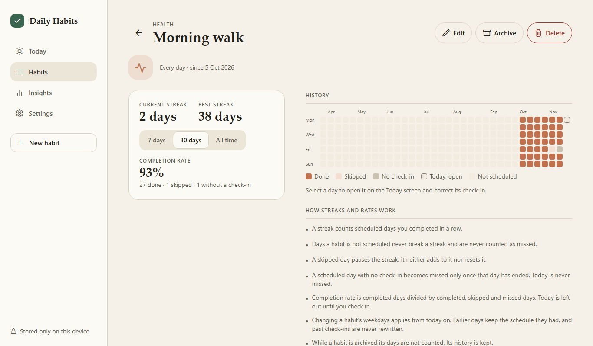
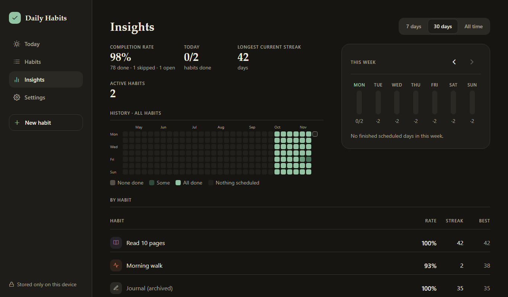
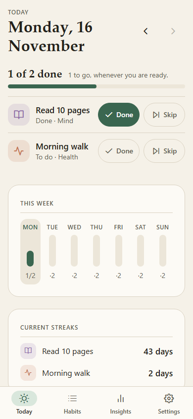
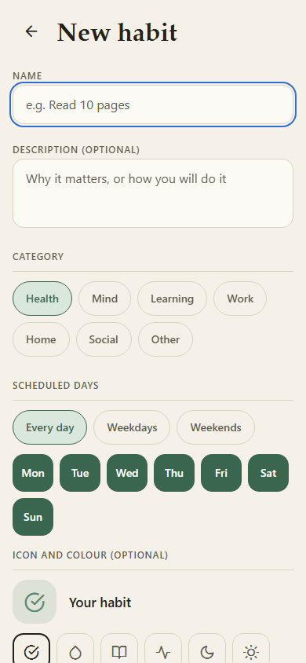
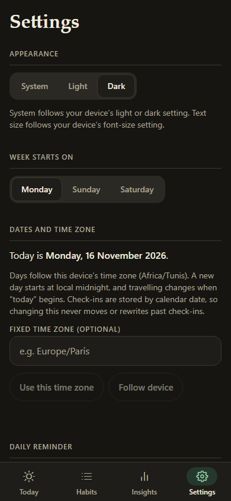
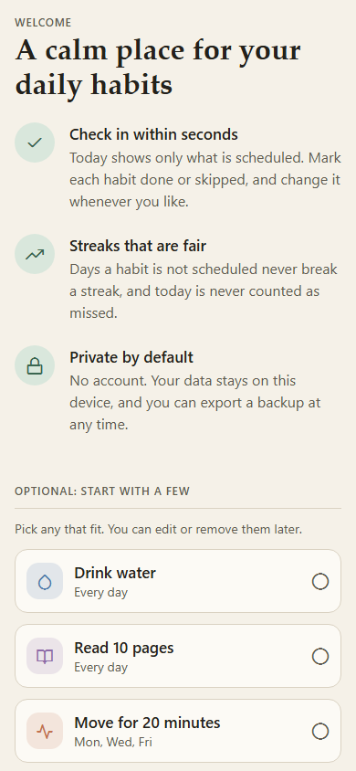

# Daily Habit Tracker App

A calm, local-first habit tracker for Android, iOS and the desktop browser, built from one TypeScript codebase with Expo SDK 58, React Native and Expo Router.

**Live web app:** https://elyes123456789.github.io/daily-habit-tracker-app/

Create habits, choose the weekdays they belong to, check in each day in a couple of taps, and see your consistency over time. There is no account and no server: your data stays on the device.

| Today (desktop) | Habit history (desktop) | Insights (desktop, dark) |
| --- | --- | --- |
|  |  |  |

| Today (phone) | New habit (phone) | Settings (phone, dark) | Onboarding (phone) |
| --- | --- | --- | --- |
|  |  |  |  |

These are real screenshots of the production web build, taken by Playwright with sample data at 1366×800 and 390×844 (`SCREENSHOTS=1 npx playwright test screenshots`). The phone-width images are the web build in a narrow browser, not captures from an Android or iOS device.

## Features

- **Habits**: name, optional description, category, icon and colour; any combination of weekdays; edit, archive, restore and delete. Deleting asks for confirmation; archiving keeps all history.
- **Today**: only the habits scheduled for the selected date. Each can be marked Done or Skip, changed, or cleared. Browse earlier days and correct them.
- **History and statistics**: per-habit heatmap, an all-habits heatmap, completion rate over 7 days, 30 days or all time, current and best streaks, and a weekly summary.
- **Reminders**: an optional time per habit and an optional daily check-in reminder. Notification permission is requested only when you switch a reminder on.
- **Settings**: light, dark or system theme; week start; time zone behaviour; JSON backup export and import; CSV export of check-ins; erase all data.
- **Accessibility**: screen-reader labels and roles, visible keyboard focus on web, 48-point touch targets, system font scaling, and reduced-motion support.

## Supported platforms

| Platform | How it is delivered | Tested in this repository |
| --- | --- | --- |
| Desktop browsers | Expo web export, a static site that can be installed as a PWA | Yes: automated browser tests on the production build |
| Android | Native app through Expo (Expo Go, a development build, or an EAS build) | Not run on a device or emulator; see [Known limitations](#known-limitations) |
| iOS | Native app through Expo (Expo Go, a development build, or an EAS build) | Not run on a device or simulator; see [Known limitations](#known-limitations) |

**Desktop support is the web app, not a native Windows or macOS program.** There is no `.exe`, `.msi`, `.dmg` or Electron/Tauri wrapper. On desktop you open the site in a browser, and in Chrome or Edge you can choose *Install app* to get a standalone window that also works offline.

Layouts adapt rather than stretch: phones and narrow windows get a bottom tab bar and a single column; from 900 px wide the app shows a sidebar and multi-column screens. The native apps use the platform's own tab bar.

## Getting started

Prerequisites:

- Node.js 22.13+ or 24.3+ (CI uses 24) and npm
- For Android: Android Studio with an emulator, or a phone with the Expo Go app
- For iOS: a Mac with Xcode for the simulator, or an iPhone with the Expo Go app

```bash
npm ci
```

| Target | Command |
| --- | --- |
| Web (development server) | `npm run web` |
| Android | `npm run android` |
| iOS | `npm run ios` |
| Choose in the terminal | `npm start` |

`expo-dev-client` is installed so EAS development builds work. Because of that, `npm start` expects a development build by default; to open the project in the Expo Go app instead, run `npx expo start --go`.

## Tests and builds

| What | Command |
| --- | --- |
| Lint | `npm run lint` |
| Type check | `npm run typecheck` |
| Unit and component tests (Jest) | `npm test` |
| Production web export to `dist/` | `npm run build:web` |
| Serve the export at http://localhost:8081 | `npm run serve:web` |
| Browser end-to-end tests (Playwright) | `npx playwright install chromium` once, then `npm run build:web && npm run test:e2e` |
| Expo diagnostics | `npx expo-doctor` and `npx expo install --check` |

What the tests cover:

- **Unit** (`src/domain/*.test.ts`): local dates across time zones, midnight, daylight-saving changes, month and year ends and leap days; schedules and schedule changes; streaks; completion rates; one check-in per habit per day; backup export, import and validation; CSV export; the storage repository.
- **Component** (`src/screens/screens.test.tsx`): creating and editing a habit, form validation, reminder permission handling, checking in, correcting and clearing a check-in, and rolling back when storage fails.
- **End-to-end** (`e2e/habits.spec.ts`, desktop and phone-sized browser): first-run onboarding, creating a habit, checking in, persistence across a reload, correcting a past day, archive/restore/delete, statistics on six weeks of seeded history, settings, a full export → erase → import round trip, unreadable stored data, and the installed-app path (manifest, service worker, working offline).

## How dates, streaks and rates work

These rules are implemented in small pure functions in `src/domain/` and shown in the app under *How streaks and rates work*.

- A check-in belongs to a **local calendar date**, stored as `YYYY-MM-DD`. It is never stored as a timestamp, and date arithmetic is done on the calendar, so daylight-saving changes cannot shift a day.
- **Time zone policy**: by default "today" follows the device's time zone and rolls over at local midnight. In Settings you can fix a specific IANA zone (for example `Europe/Paris`) instead. Changing the zone only changes which date counts as today from then on; existing check-ins keep the date they were recorded under.
- There is at most **one check-in per habit per date**. Checking in again replaces it.
- A **streak** counts scheduled days completed in a row. Unscheduled weekdays are ignored: they neither break a streak nor count as missed.
- A **skipped** day pauses a streak: it does not add to it and does not reset it.
- A scheduled day with no check-in becomes **missed only once that day has ended**. Today is never missed, and an unfinished today does not break a streak.
- **Completion rate** = done ÷ (done + skipped + missed). Today is left out until you check in.
- **Changing a habit's weekdays** takes effect from the day you change them. Earlier days are still judged by the schedule they had at the time, and past check-ins are never rewritten.
- **Archived** habits stop counting days while archived. Their history is kept and they can be restored.
- Reminder times use the device's clock.

## Data, privacy and backups

- All data is stored **on the device only**, as one JSON document in AsyncStorage: app-private storage on Android and iOS, and the browser's `localStorage` on web. The app works offline.
- There is **no account, no backend, no analytics and no network request for your data**. No API keys or environment variables are needed, so there is no `.env` file.
- **Nothing syncs.** Each device, and each browser on a device, has its own separate data. Clearing a browser's site data or uninstalling the app deletes it.
- To move or protect your data, use **Settings → Export backup (JSON)** and **Import backup** on the other device. Import validates the file, explains what is wrong if it cannot be read, and asks before replacing what is on the device. Backups carry a format version (currently 1); a file with a different version is refused with a message rather than guessed at.
- **Export check-ins (CSV)** writes one row per check-in (`date,habit,category,status`) for spreadsheets.
- If stored data cannot be read at startup, the app says so and leaves it untouched unless you choose to erase it.

### Reminders by platform

| Platform | Behaviour |
| --- | --- |
| Android, iOS | Local notifications scheduled with `expo-notifications`. They are delivered by the system even when the app is closed. |
| Web | The browser Notification API, with no push server. A reminder can only appear **while the app is open** in a tab or installed window, and is skipped if you have already checked in. If the browser has no notification support or permission is blocked, the app explains this and everything else keeps working. |

## Project structure

```
src/
  app/          Expo Router routes only (thin files that render a screen)
  screens/      Screen components
  components/   Reusable UI, tab bar and desktop sidebar (.web.tsx where web differs)
  domain/       Pure business rules: dates, schedules, streaks, backups (+ tests)
  data/         Storage repository and the app store (React context)
  services/     Reminders and file import/export, with native and web variants
  hooks/        Theme, layout breakpoints, reduced motion
  theme.ts      Design tokens: colours, type, spacing, radii
e2e/            Playwright tests
public/         PWA manifest, service worker, icons
scripts/        Icon generator
```

## GitHub repository and CI

Repository: https://github.com/elyes123456789/daily-habit-tracker-app (public, default branch `main`). Workflows live in `.github/workflows/`:

| Workflow | Runs on | What it does |
| --- | --- | --- |
| `ci.yml` | Pull requests, pushes to `main`, manual | `npm ci`, Expo dependency check, Expo Doctor, lint, type check, Jest, production web export, then Playwright tests in a second job. Read-only token, no secrets. |
| `deploy-web.yml` | Pushes to `main`, manual | Builds the web app for its Pages path and deploys it with the official GitHub Pages actions. Skipped unless the `ENABLE_PAGES` variable is `true` (below). |
| `eas-build.yml` | Manual only | Starts an EAS build for Android and/or iOS with the chosen profile. Fails with a clear message until EAS is set up (below). |

### GitHub Pages deployment

The web app is deployed at **https://elyes123456789.github.io/daily-habit-tracker-app/** and redeploys on every push to `main`. A Pages site is public on the internet. The app holds no data of yours (data lives in each visitor's browser), but anyone can open it.

The deployed site was checked in a headless browser: first-run onboarding, creating a habit, checking in, persistence after a reload, refreshing on deep links (`/habits`, `/insights`, `/settings`, `/habit-form`), the manifest, the service worker and an offline reload all worked, and unknown addresses show the app's not-found page.

The deployment depends on two repository settings, both already in place:

1. **Settings → Pages → Build and deployment → Source**: **GitHub Actions**.
2. **Settings → Secrets and variables → Actions → Variables**: `ENABLE_PAGES` = `true`. Delete or change this variable to stop deploying. To take the site down, also unpublish it under Settings → Pages.

On a private repository, GitHub Pages requires a paid GitHub plan. The workflow reads the base path from GitHub and builds for it, so it also works unchanged under a custom domain. The URL of each deployment is shown on the workflow run's *Deploy* job and in the repository's `github-pages` environment.

Without Pages, `npm run build:web` produces a `dist/` folder that any static host can serve. CI also uploads it as a workflow artifact named `web-dist`; that is a downloadable build, not a deployment.

### EAS builds

EAS is set up: the app is linked to the Expo project [`@elyesghouma/daily-habit-tracker-app`](https://expo.dev/accounts/elyesghouma/projects/daily-habit-tracker-app) (`extra.eas.projectId` in `app.json`), and the `EXPO_TOKEN` repository secret holds an Expo access token. The token itself is never committed. No build has been started yet.

To build, run **Actions → EAS mobile build → Run workflow** and choose a platform and profile, or locally `npx eas-cli@latest build --platform android --profile preview`.

To set this up on a fork or another account: `npx eas-cli@latest login`, change `owner` in `app.json`, run `npx eas-cli@latest init`, then create a token at **expo.dev → Account settings → Access tokens** and save it as the repository secret `EXPO_TOKEN`.

Profiles in `eas.json`: `development` (development client, internal distribution), `preview` (internal distribution, APK on Android) and `production` (store-ready, auto-incremented version). iOS builds need an Apple Developer account. The Android package and iOS bundle identifier are both `com.dailyhabittracker.app`; change them in `app.json` before publishing to a store. The workflow only starts builds, which count against your Expo plan's build quota; it never submits to the App Store or Google Play.

## Known limitations

- **Native apps were not run.** No Android emulator, iOS simulator or physical device was available where this was built, so native navigation, safe areas, notifications, and file sharing and import on Android and iOS are written against the SDK 58 APIs and type-checked, but untested on a device. Test on a device before relying on them.
- **Web reminders need the app open** (see above).
- **No sync between devices.** Use export and import.
- **Web storage limits**: data lives in `localStorage`, which browsers may clear in private windows or when site data is cleared.
- The history heatmap's individual days are not keyboard-focusable (there can be over 300 of them). Keyboard users reach any date with the previous-day and next-day buttons on Today.
- The time fields for reminders are typed as 24-hour `HH:MM` text rather than a native time picker.
- Dates and weekday names are shown in English only.
- No licence has been chosen for this code yet.
